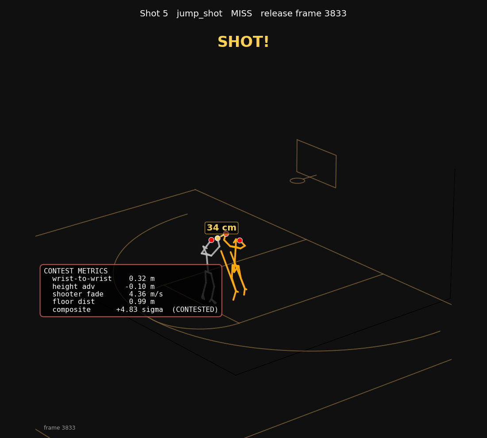
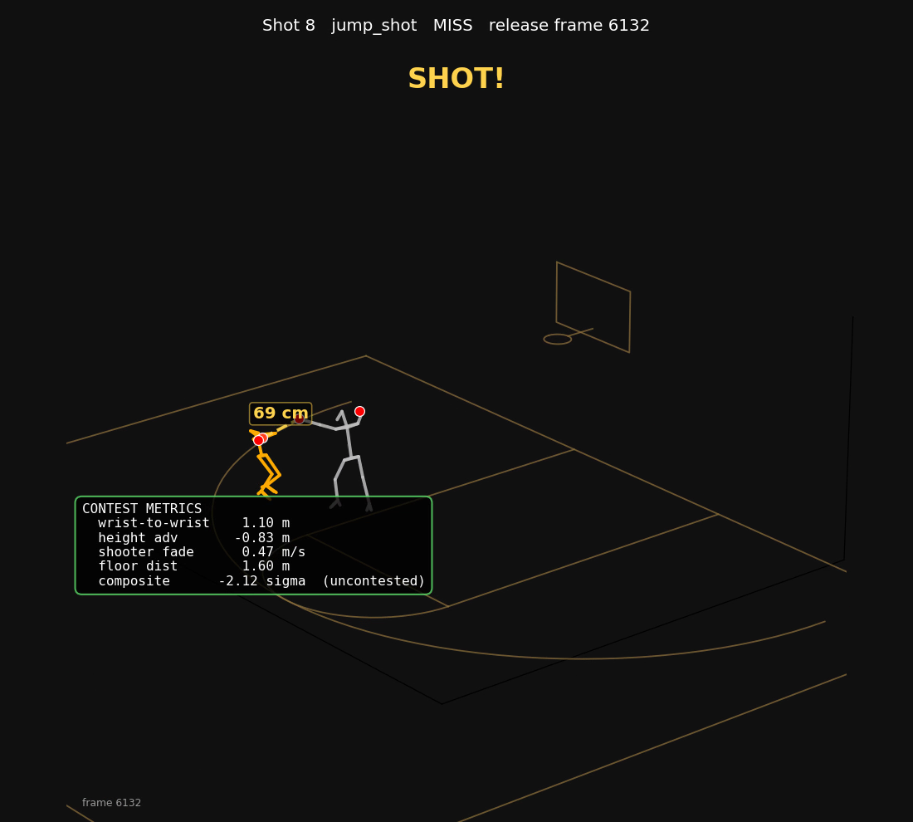
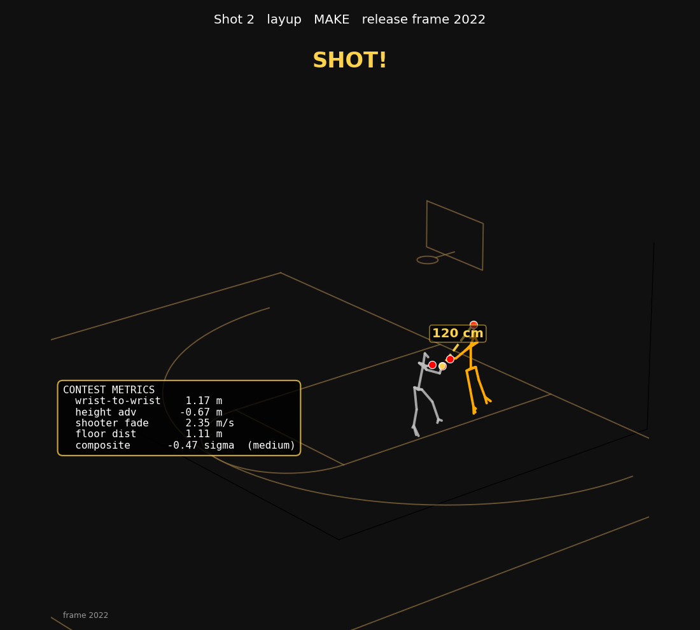
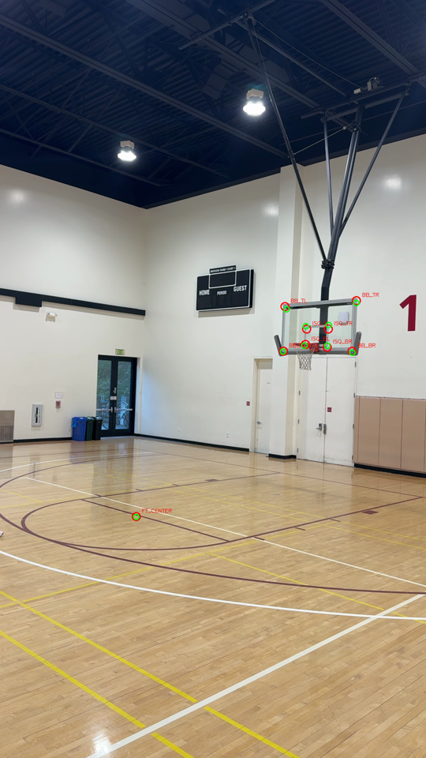
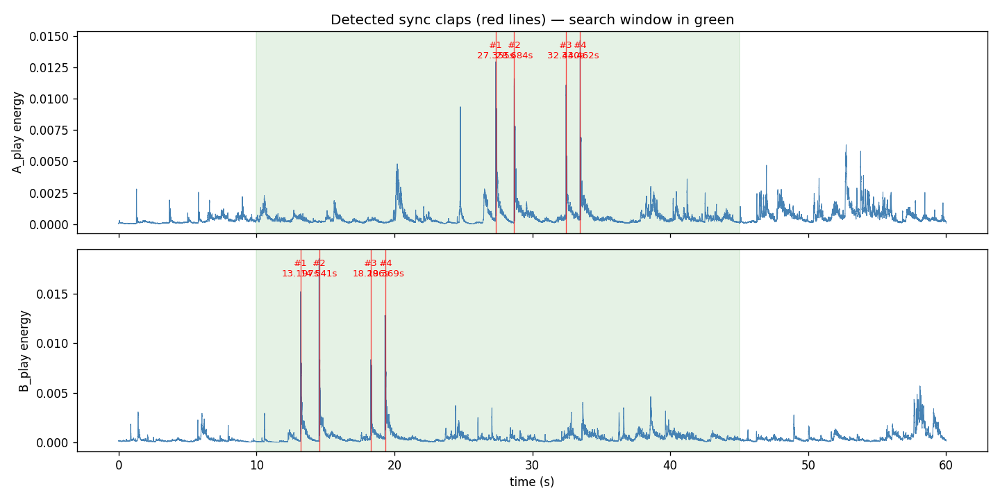
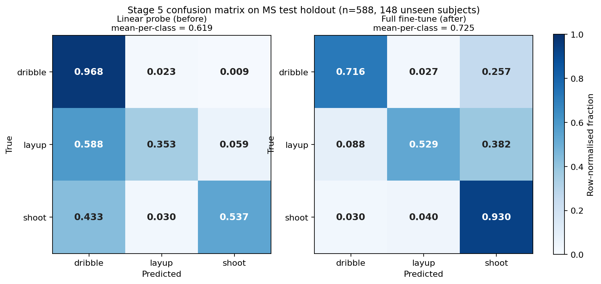
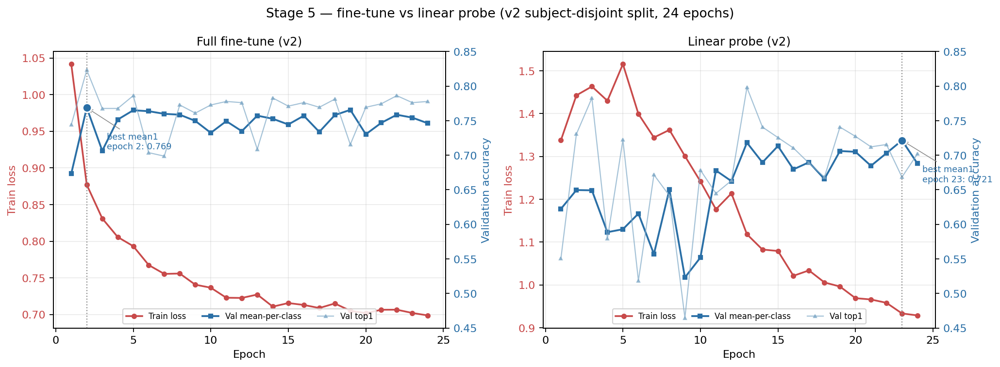
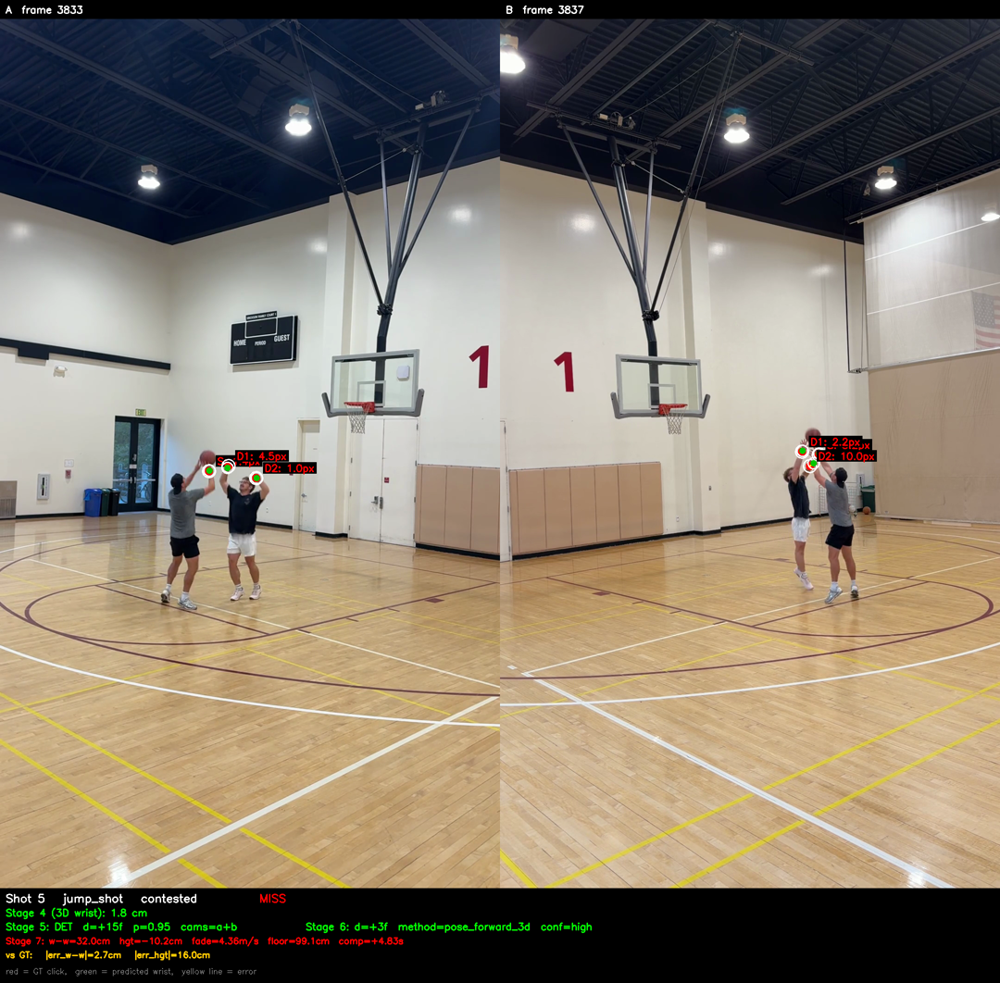

# CourtVision

**Multi-view 3D skeletal tracking and a 5-measurement defender-pressure (contest) metric for half-court basketball, from synchronized iPhone footage.** Stanford CS231N final project, Spring 2026.

Hand a CourtVision pipeline two iPhone clips of a 1-on-1 game and 5–10 minutes of one-time calibration; out comes a per-shot 3D skeletal reenactment of every shooter / defender pair at the release frame, scored on five contest measurements (wrist-to-wrist distance, wrist-height advantage, shooter fade, floor distance, and a composite z-score). On a hand-labelled 15-shot test session, the composite metric separates makes from misses by **3.47 σ** and wrist-to-wrist distance correlates with miss outcome at **Spearman ρ = −0.70 (p = 0.025)**.

The headline novel measurement is the **3D distance between the closest defender's nearer wrist and the shooter's shooting wrist** at release — a pose-only proxy for NBA SportVU's floor-distance convention that captures contest information the floor-distance metric misses (defender 1.5 m away on the floor but hand near the trajectory is more contested than defender 1.5 m away with hand at hip).

---

## Demo

3D skeletal reenactments at the release frame, with the 5-measurement contest panel overlaid. Panel border colour-coded by composite z-score (green = uncontested, amber = medium, red = heavily contested). Dashed yellow line = closest defender wrist → shooter shooting wrist.

| Heavily contested fadeaway | Open (uncontested) shot | Made layup |
|:---:|:---:|:---:|
|  |  |  |
| Shot 5: w-w 32 cm, fade 4.36 m/s, composite **+4.83 σ** (MISS) | Shot 8: defender's hands 83 cm below shooter, composite **−2.12 σ** | Shot 2: open driving layup, composite **−0.47 σ** (MAKE) |

🎬 **[Full 60-second highlight reel of 5 shots →](docs/figures/highlight_reel.mp4)**

---

## Headline results

All numbers from the deployed pipeline running on iPhone session `2026-06-02_1on1` (15 hand-labelled shots, 2 cameras, 180 s of play). Full per-stage detail in `docs/report_content.md` § 5.

| Stage | What it does | Headline result |
|---|---|---:|
| Stage 1 — player tracking (YOLOv8m + ByteTrack) | Per-camera multi-track boxes | Qualitative accept (F15) |
| Stage 2 — 2D pose (RTMPose-l Halpe-26 via rtmlib ONNX) | Per-track 26-keypoint pose | Wrist PCK@0.05 vs hand-labelled GT: **0.93 / 0.95** (cam A / B) |
| Stage 3 — ball detection | (Dropped 2026-05-28 via F19) | NOT BUILT |
| Stage 4 — 3D triangulation (custom 2-camera DLT + Hungarian cross-camera ID matching) | 18 002 3D poses produced | Median 3D wrist error **3.94 cm** vs hand-clicked GT (n=13); 3.9 cm calibration sanity at 12.5 m baseline |
| Stage 5 — shot classifier (PoseConv3D SlowOnly-R50, fine-tuned on MultiSubjects) | Sliding-window action classification | **0.93 shoot accuracy** on MS v2 test holdout (vs 0.54 K400 linear-probe baseline); session P / R / F1 = 0.40 / 0.80 / 0.53 |
| Stage 6 — release-frame extractor (pose-only `pose_forward` rule) | Predicts the exact release frame | Median Δframes = **+3.5 frames** (~58 ms) vs GT on the session |
| Stage 7 — 5-measurement contest metric (pose-only, Decision 9 redesign / F25) | Per-shot defender-pressure score | Makes vs misses: composite **−2.84 vs +0.63 σ (3.47 σ gap)**; wrist-to-wrist Spearman ρ = **−0.70, p = 0.025** |
| Cross-cutting — F24 cross-method gate | Stage 5 + Stage 6 disagreement → FP filter | 4/9 → 4/5 precision lift on TrackID3x3 detected events |

---

## What CourtVision is, mechanically

```
2 iPhones ──┬─► Stage 1   ─► Stage 2  ─► Stage 4   ─► Stage 7  ─► [5 contest measurements at release]
60 fps      │   (boxes)     (2D pose)   (3D pose)     │
1080p       │                                         │
            └─► Stage 5 ─► Stage 6 ──────────────────►┘
                (shot       (release
                 events)     frame)
```

- **Inputs**: two synchronized iPhone clips + ~5 min of one-time calibration (chessboard intrinsics + court-landmark extrinsics + 4 hand-claps for audio sync).
- **Outputs per detected shot**: 3D player + defender skeleton at the release frame, the 5 contest measurements, an instant + 5-frame-smoothed value for each, an `uncontested` flag, and a 3-second 3D reenactment video with the metric panel overlaid.
- **Pipeline is pose-only** — no ball detector (Phase D dropped via F19; the original wrist-to-trajectory measurement stays in the schema as a Phase 2 escalation if a working ball detector lands).

Detail and motivation for every architectural choice is in `docs/decisions.md` (10 locked technical decisions) and `flags.md` (26-entry issue log of every deviation, fix, and accepted caveat).

---

## Where everything lives

| What you want | File |
|---|---|
| **Full narrative writeup** (stage by stage, results, decisions, deployment story) | `docs/development_log.md` |
| **Factual dump** (exact numbers, hyperparameters, tables, BibTeX, file paths) | `docs/report_content.md` |
| Stage 5 training method (recipe + ablations) | `docs/stage5_training_method.md` |
| Stage 2 evaluation report (PCK breakdown) | `docs/stage2_evaluation_report.md` |
| Architectural decisions (with rationale + alternatives considered) | `docs/decisions.md` |
| Issue log (every PRD deviation and fix) | `flags.md` (F1–F26) |
| Original PRD (planned design, before deployment-driven changes) | `CourtVision_PRD.md` (root) and `docs/prd.md` |
| Sprint plan (Phase A → E build schedule) | `docs/sprint_plan.md` |

---

## Setup

All project CLIs (`modal`, `pytest`, `python`, etc.) live inside the `uv`-managed virtualenv. Prefix every command with `uv run`, or activate the venv once with `source .venv/bin/activate`.

```bash
# 1. Sync deps (Python 3.11).
uv sync --extra dev

# 2. Fill in tokens (WANDB / Modal / HF if you'll re-run training).
cp .env.example .env

# 3. Modal auth.
uv run modal token new

# 4. (Optional) Pre-commit hooks.
uv run pre-commit install

# 5. Smoke tests.
uv run pytest
```

`.env` provides `WANDB_API_KEY` (training only); pipelines run fine without it.

---

## Reproducing the headline results on a new session

The end-to-end pipeline that produced every number above is the `scripts/run_session_pipeline.py` orchestrator. Capture, calibrate, label, run, evaluate — start to finish.

### 1. Capture

- Two iPhones on tripods at opposite ends of the half-court.
- AE/AF locked on each (point at court centre, tap-hold to lock; this matters — autofocus drift invalidates intrinsics).
- 60 fps (will be detected automatically; cam A may actually run 59.94 NTSC drop-frame).
- 4 hand-claps at the start (for audio sync).
- Record ~5 minutes of play.

### 2. One-time intrinsic calibration (per phone)

Print a 9 × 6 chessboard (30 mm squares), record a 30-second video moving it through ~20 positions.

```bash
uv run python scripts/calibrate_intrinsics.py \
  --video Datasets/calibration/checker_A.MOV \
  --output data/calibration/intrinsics_A_checker.json
# (Repeat for B.)
```

Expect RMS reprojection 1–3 px. Anything > 5 px means re-shoot the chessboard video.

### 3. Per-session calibration

```bash
# Audio sync (4 claps, both cameras).
uv run python scripts/detect_claps.py \
  --video-a Datasets/iPhone/A_play.MOV \
  --video-b Datasets/iPhone/B_play.MOV \
  --output data/sessions/<session>/sync.json

# Extrinsics — click ~10 court landmarks in the first frame of each camera.
uv run python scripts/calibrate_extrinsics.py \
  --session <session> --camera A
uv run python scripts/calibrate_extrinsics.py \
  --session <session> --camera B

# Sanity-check: triangulate shared landmarks; expect mean error <= 5 cm at 12 m baseline.
# (Lives inside run_session_pipeline.py's _sanity_check.)
```

### 4. End-to-end Stage 1 → 4 (tracking + 2D pose + 3D triangulation)

```bash
# Trim videos to the sync window, run Stage 1 + Stage 2 in parallel on both cameras,
# then triangulate with per-frame Hungarian cross-camera ID matching.
uv run python scripts/run_session_pipeline.py --session <session>
```

Outputs: `outputs/sessions/<session>/{tracks_cam_*.json, pose2d_cam_*.json, pose3d.json, stage{1,2,4}_overlay_cam_*.mp4}`.

### 5. Hand-label shots for GT

```bash
# Open the labeling UI — for each shot click release frame + 3 wrist clicks per camera.
uv run python scripts/label_shots.py --session <session>

# Paginated review (catch fat-fingered clicks).
uv run python scripts/review_shots.py --session <session>
```

### 6. Stage 5 → 6 → 7 (shot detection → release frame → contest metric)

```bash
# Stage 5 — shot classifier (runs on Modal; image takes ~10 min cold-start, ~1-2 min warm).
uv run modal run --detach scripts/stage5_modal.py::infer_session \
  --session <session> --shoot-threshold 0.75

# Stage 6 — release-frame prediction (3D pose-forward rule).
uv run python scripts/detect_releases_session.py --session <session>

# Stage 7 — 5-measurement contest metric (instantaneous + 5-frame smoothed + composite z).
uv run python scripts/compute_contest_session.py --session <session>
```

### 7. Evaluation + deck-grade visualization

```bash
# All-stage eval vs hand-labelled GT → outputs/sessions/<session>/evaluation.json.
uv run python scripts/evaluate_session.py --session <session>

# Per-shot review PNGs (side-by-side cam A/B at release + 6-line caption with all 5 metrics).
uv run python scripts/review_evaluation.py --session <session> --out-subdir eval_review_full_metrics

# 3D skeletal reenactments with metric panel (3 s/shot, 180° orbiting camera, contest dashed line).
uv run python scripts/render_3d_reenactment.py --session <session> \
  --shot-ids 0,2,5,7,11 --out-subdir 3d_reenactments_full_metrics
```

---

## Pipeline stages — what was built

Concise tour. Full content is in `docs/development_log.md`.

### Stage 1 — Player tracking (YOLOv8m + ByteTrack)

Off-the-shelf via ultralytics, no training. Track-persistence acceptance was qualitative on TrackID3x3 indoor clips. Six tuning layers (`C2/B2/A2/A3/D1/D2`) deferred per F15; revisit if iPhone footage shows more ID switches.

### Stage 2 — 2D pose (RTMPose-l Halpe-26 via rtmlib ONNX)

`rtmlib` (ONNX runtime), **not** MMPose, because torch 2.12 + CUDA 13 cannot build `mmcv._ext` (F20). Same model, same weights, same `Pose2DSequence` schema — only the runtime stack changed. PCK against TrackID3x3 model-derived GT is 0.655 at the 12 px tolerance; against hand-labelled iPhone-session GT is **0.93 / 0.95** for cam A / B respectively. The lower TrackID3x3 number is a model-derived-GT artifact (F18 / F21).

### Stage 3 — Ball detection [DROPPED — F19]

WASB-SBDT was downloaded and tested but ball coverage on TrackID3x3 amateur footage was too partial for downstream Stage 5 / Stage 7 use. Phase D dropped 2026-05-28; Stage 5/6/7 pivoted to pose-only. Code retained for a Phase 2 attempt on iPhone footage (`src/courtvision/stage3_ball/`).

### Stage 4 — 3D triangulation (custom 2-camera DLT)

Custom pipeline, not Pose2Sim. Chessboard intrinsics (`cv2.calibrateCamera`, ~2 px RMS on both cameras), court-landmark extrinsics (`cv2.solvePnP` with iterative {EPNP, SQPNP, IPPE, iterative} × greedy-outlier-drop, ~4 px mean reproj on 9 of 17 / 12 of 17 landmarks), audio-clap inter-camera sync (`fps_b/fps_a` drift correction — 60.000 / 59.940 = 1.001 slope is real), and per-frame **Hungarian cross-camera ID matching** on pelvis reprojection error to solve the cross-camera ID problem (ByteTrack reissues ~10 track IDs per camera over 180 s). Triangulation sanity: 3.9 cm mean error on 9 shared landmarks at 12.5 m baseline. End-to-end median wrist 3D error: **3.94 cm** vs hand-clicked GT.

| Calibration diagnostic — extrinsics on cam A | Audio-clap sync agreement |
|:---:|:---:|
|  |  |
| Red = clicked court landmarks; green = reprojected from solved camera pose. 9 of 17 landmarks accepted; mean reproj 4.89 px (EPNP) | 4 of 4 claps detected on both cameras; max disagreement 64 ms (1 frame at 60 fps). Drift slope b/a = 1.0010 (NTSC 59.94 vs 60.00) |

### Stage 5 — Shot classifier (PoseConv3D, fine-tuned)

The only trained model in the project. SlowOnly-R50 backbone, K400-pretrained, fine-tuned on MultiSubjects with a 64-frame contiguous sliding-window recipe (the v1 `UniformSampleFrames` mistake is documented in F22; the fix is "train as you deploy"). Subject-disjoint v2 split (148 unseen test subjects). Headline test result: **shoot 0.93 / mean-per-class 0.725**, vs linear-probe baseline of 0.54 / 0.619 — fine-tuning is worth +39 pts shoot accuracy. Regularisation ablation showed reg trades shoot for dribble — overfitting wasn't the binding constraint; the data is.

| Linear probe vs full fine-tune — confusion matrices | Training curves |
|:---:|:---:|
|  |  |
| Linear probe (left): shoot 0.54 / mean-per-class 0.62. Full fine-tune (right): shoot **0.93** / mean-per-class 0.73. **+39 pts** on the deployment metric | Val mean-per-class over 24 epochs. Linear probe plateaus ~ep 23 at 0.72; fine-tune peaks ep 2 at 0.77 |

| Test-set results (Stage 5 — MultiSubjects v2 subject-disjoint, 588 test clips, 148 unseen subjects) | Linear probe (frozen K400) | Full fine-tune | Δ |
|---|---:|---:|---:|
| Dribble accuracy (n = 222) | **0.968** | 0.716 | −0.252 |
| Layup accuracy (n = 68) | 0.353 | 0.529 | +0.176 |
| **Shoot accuracy (n = 298)** | 0.537 | **0.930** | **+0.393** |
| Overall accuracy | 0.679 | **0.803** | +0.124 |
| **Mean per-class** | 0.619 | **0.725** | **+0.106** |

### Stage 6 — Release-frame extractor (pose-only, F23 deviation)

2D pose-only because Phase D dropped and Stage 4 was iPhone-gated at the time of build. Primary rule: `pose_forward` — onset of the first sustained `wrist_y < shoulder_y ∧ elbow ≥ 160°` interval, with `release_offset = −1` (user-calibrated on 36 MultiSubjects overlays). Secondary: `pose_apex` — peak wrist Z. The disagreement between the two is F24's cross-method false-positive filter.

### Stage 7 — 5-measurement contest metric (pose-only, Decision 9 redesign / F25)

Phase D-drop redesign that preserves Decision 9's framework while pivoting to pose-only proxies. Five measurements at release: (1) `wrist_to_wrist_distance_m`, (2) `wrist_height_advantage_m`, (3) `shooter_fade_mps` (= `sqrt(max(0, −v_forward)² + v_lateral²)`), (4) `floor_distance_m` (NBA SportVU baseline), (5) `composite_score` (sign-corrected sum of z-scores; bigger = more contested). Closest defender by 3D pelvis-to-pelvis; shooting hand by higher wrist at release. Instantaneous and 5-frame smoothed values reported; `uncontested` flag triggers at floor distance > 3 m.

Make / miss separation on the iPhone session (n = 2 makes, 9 misses among evaluable):

| Measurement | Makes mean | Misses mean | Δ (makes − misses) |
|---|---:|---:|---:|
| (1) Wrist-to-wrist distance | 1.39 m | 0.74 m | **+65 cm** (makes more open) |
| (2) Wrist height advantage | −1.07 m | −0.18 m | **+89 cm** (makes had defender's hand much lower than shooter's) |
| (3) Shooter fade | 1.24 m/s | 1.04 m/s | +0.20 m/s |
| (4) Floor distance (pelvis) | 1.14 m | 1.33 m | −0.18 m (counter-intuitive — see Discussion in `docs/development_log.md`) |
| **(5) Composite z-score** | **−2.84** | **+0.63** | **−3.47 σ separation** |

Spearman ρ vs make/miss outcome: **ρ = −0.696, p = 0.025 (n = 10)** for wrist-to-wrist distance — significant at α = 0.05, smaller w-w distance → more likely to miss.

Per-shot evaluation review (one PNG per shot, 15 total, in `outputs/sessions/<session>/eval_review_full_metrics/`):



*Side-by-side cam A / cam B at the release frame. Red circles = hand-labelled GT wrist clicks; green = Stage 2 predicted wrists; yellow lines + numbers = pixel error. 6-line caption shows all per-stage results: Stage 4 (3D wrist error in cm), Stage 5 (detection Δframes / confidence / cameras matched), Stage 6 (release-frame Δ / method), Stage 7 (all 5 measurements + errors vs GT).*

### Stage 8 — 3D demo (★ stretch)

Effectively delivered via the `scripts/render_3d_reenactment.py` skeletal reenactments + highlight reel (3-second clip per shot, orbiting camera, dashed contest line, on-screen metric panel colour-coded by composite z). A standalone interactive 3D viewer remains stretch.

### Cross-cutting — F24 cross-method gate

Stage 5 (CNN on pose heatmaps) and Stage 6 (explicit geometric rule on the same pose) act on identical input. When the two methods disagree (`forward_conf == "low"` because no sustained extension found), the Stage 5 fire is probably a false positive. Implementation: lower Stage 5's threshold from 0.75 → 0.6 to recover borderline real shots, then gate with `is_verified_shot()` from Stage 6.

---

## Datasets

Detail in `docs/report_content.md` § 2.

| Dataset | Used for | Status |
|---|---|---|
| **MultiSubjects** (Henan U., CVIU 2024) | Stage 5 training (subject-disjoint v2 split: 2914 / 594 / 588 clips, 692 / 148 / 148 subjects); Stage 2 secondary PCK | Done |
| **TrackID3x3** (open-starlab) | Stage 2 acceptance (13 indoor clips); Stage 5 qualitative review; F24 calibration sample | Done |
| **Kinetics-400** | PoseConv3D backbone pretraining (13 MB MMAction2 checkpoint) | Done |
| **FineSports** (CVPR 2024) | Intended for the Path C 4-stage transfer pipeline | Labels never delivered → deferred |
| **DeepSportradar Basketball Instants** | Substitute for the verified-404 "U Arizona Roboflow basketball" | Ball detector dropped before mAP measured |
| **Own iPhone footage** (`2026-06-02_1on1`) | End-to-end deployment evaluation (15 hand-labelled shots) | Done |

---

## Repository layout

```
src/courtvision/                  package code
├── schemas.py                    cross-stage I/O contracts (Track, Pose2D/3D, ShotEvent, ReleaseFrame, ContestMeasurement)
├── modal_app.py                  Modal app + per-stage isolated images + Volume bindings
├── stage1_detection/             YOLO + ByteTrack runner
├── stage2_pose/                  RTMPose-l ONNX (via rtmlib), halpe26_to_coco17 converter, overlays
├── stage3_ball/                  WASB + YOLO ball pipelines (kept for Phase 2)
├── stage4_triangulation/         2-camera DLT primitives (calibration done in scripts/)
├── stage5_classifier/            PoseConv3D model + inference + subject-disjoint split + overlay
├── stage6_release/               pose_forward + pose_apex rules + cross-method gate
└── stage7_contest/               (schema only; implementation lives in scripts/compute_contest_session.py)

scripts/                          CLI entry points + the iPhone-session orchestration
├── calibrate_intrinsics.py       chessboard calibration
├── calibrate_extrinsics.py       court-landmark calibration with iterative solver
├── detect_claps.py               audio sync
├── run_session_pipeline.py       trim + tracking + 2D pose + 3D triangulation orchestrator
├── label_shots.py                GT labeling UI (release frame + wrist clicks)
├── review_shots.py               paginated GT review
├── stage5_modal.py               Stage 5 training + inference on Modal (includes infer_session entrypoint)
├── detect_releases_session.py    Stage 6 on 3D pose
├── compute_contest_session.py    Stage 7 — the 5-measurement implementation
├── evaluate_session.py           per-stage eval vs hand-labelled GT
├── review_evaluation.py          per-shot review PNGs (full 5-metric caption)
├── render_3d_reenactment.py      3D skeletal reenactment video (orbiting camera + metric panel)
└── stage{1,2,3}_{run,eval,visualize}.py   per-stage standalone runners

configs/                          Hydra config tree (per-stage + Modal)
tests/                            pytest suite (schemas + per-stage smoke)
docs/                             development log, report content, decisions, PRD, stage writeups
data/                             session captures + calibration JSONs (gitignored)
outputs/                          inference outputs + eval review PNGs + 3D reenactments (gitignored)
flags.md                          26-entry issue log
```

---

## Project status

| Stage | Status | Result |
|---|---|---|
| Phase A (scaffold + schemas) | Done | All schemas locked at `extra="forbid"` |
| Phase B (Stage 1 tracking) | Done | Off-the-shelf, qualitative accept |
| Phase C (Stage 2 pose) | Done | rtmlib pivot per F20; wrist PCK 0.93 hand-labelled |
| Phase D (Stage 3 ball) | **DROPPED** (F19) | Coverage insufficient on TrackID3x3 |
| Phase E (Stage 5 classifier) | Done | 0.93 shoot accuracy, +39 pts vs linear-probe |
| Stage 4 (3D triangulation) | Done | 3.94 cm median wrist 3D error |
| Stage 6 (release frame) | Done | Median Δ +3.5 frames |
| Stage 7 (contest metric) | Done | 3.5 σ make/miss separation, Spearman ρ = −0.70 |
| Stage 8 (3D demo) | Stretch — partial | 3D reenactment videos with metric panel shipped; standalone viewer stretch |
| iPhone session deployment | Done | 15 shots, 2 cameras, 180 s |
| Final report | In progress | See `docs/development_log.md` + `docs/report_content.md` |

---

## Limitations and future work

Reflected at depth in `docs/report_content.md` § 9 + `docs/development_log.md` § 13.8.

- **n = 15 shots is too small for inferential statistics with the rare class** (only 3 makes). Make/miss correlation on wrist-to-wrist is significant at α = 0.05, but the composite z-score and Mikic-effect quartile reproductions are gated on a larger session (≥ 30 shots).
- **Stage 5 precision (0.40) is the bottleneck.** Most of the FPs are defender contest poses; the classifier was never trained on a "defender contest" class (Decision 5 had `{dribble, layup, shoot, background}` only). A `frame_interval=2` window-extent experiment (an attempted fix for the 60 fps deployment / 25 fps training mismatch) was tried and ruled out as a cause — see the F27 negative result. **The fix is on the training-data side**: add a defender-contest class, or apply F24's cross-method gate more aggressively.
- **No third camera ⇒ no triangulation hold-out** (Decision 4's intended 5 px gate). Substituted with shared-landmark sanity (3.9 cm mean).
- **2 Stage-6 outlier shots** at the iPhone clip boundary inflate Stage 4 / 6 / 7 means. Median values are unaffected.
- **No ball detector ⇒ no wrist-to-trajectory measurement.** Schema slot retained for Phase 2 (`ContestMeasurement.flags` includes `weak_triangulation` for this case).
- **Rater study for Stage 7 composite weights** dropped to future work (★ stretch, Decision 9).

---

## Contributing / collaboration model

Two Claude Code terminals collaborated on this project. One owned Stages 1 / 2 / 3 / 5 / 6 + the F24 cross-method gate (training + benchmark focus); the other owned Stages 4 / 7 + the end-to-end iPhone deployment (3D pipeline focus). Hand-off via `flags.md` (shared issue log), `docs/decisions.md` (shared rationale log), and `docs/development_log.md` (shared narrative with explicit section ownership noted in the header).

AI usage disclosure (per CS231N guidelines): all code and docs in this repo were written with Claude Code assistance.

---

## Citation

If you use CourtVision in published work, please cite:

```bibtex
@misc{courtvision2026,
  title  = {CourtVision: Multi-view 3D skeletal tracking and a 5-measurement contest metric for half-court basketball},
  author = {Allard, Lukas},
  year   = {2026},
  note   = {Stanford CS231N final project},
  url    = {https://github.com/lukasa1/CourtVision}
}
```

Plus the foundational works (full BibTeX in `docs/report_content.md` § 8): PoseConv3D (Duan et al., CVPR 2022), RTMPose (Jiang et al., 2023), YOLOv8 (Jocher et al., 2023), ByteTrack (Zhang et al., ECCV 2022), MultiSubjects (Henan U., CVIU 2024), Pose2Sim (Pagnon et al., 2022), and the multi-view geometry / camera-calibration literature (Hartley & Zisserman 2003, Zhang 2000, Lepetit et al. 2009 EPNP, Terzakis & Lourakis 2020 SQPNP, Kuhn 1955 Hungarian).
